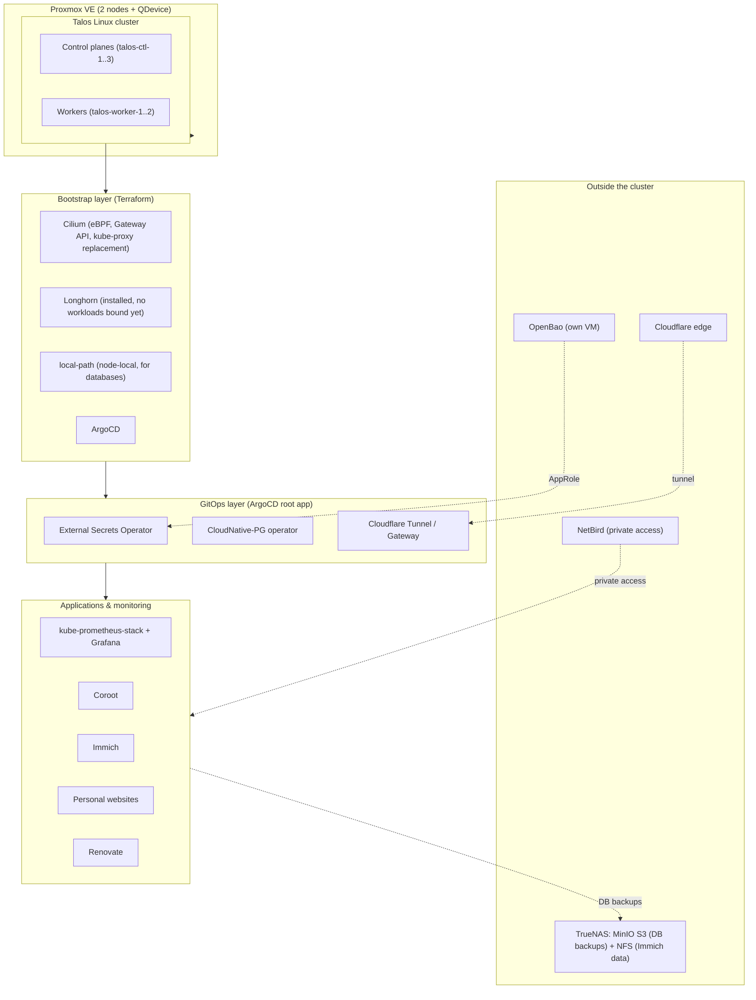

# Talos + Proxmox Kubernetes Homelab

[](https://www.talos.dev/)
[](https://kubernetes.io/)
[](https://argo-cd.readthedocs.io/)
[](https://cilium.io/)
[](https://longhorn.io/)
[](https://cloudnative-pg.io/)
[](https://www.terraform.io/)
[](https://openbao.org/)

A five-node Talos Linux Kubernetes cluster running on a two-node Proxmox VE setup. I built this to practice platform engineering end to end: provisioning with Terraform, running an immutable OS, eBPF networking, GitOps with ArgoCD, keeping secrets out of Git, and making sure I can actually restore my databases.

**This is a learning lab that I run with production habits. It is not a real production system.** It's one site, just me running it, and there are no SLOs. I put the [Known limitations](#️-known-limitations) right near the top on purpose because I'd rather tell you where the gaps are myself than have you find them digging through the repo.

**Jump to:** [At a glance](#-at-a-glance) · [Architecture](#-architecture) · [Decisions](#-key-decisions) · [Limitations](#️-known-limitations) · [Backups & DR](#-backups--disaster-recovery) · [Bootstrap](#-bootstrap-guide) · [Roadmap](#-roadmap)

> I renamed this repo to `Talos-Proxmox-Homelab`. It used to be `Talos-KubeSpan-Homelab` back when I had one control-plane node sitting on a cloud VPS using KubeSpan. Now all the nodes are local and I don't use KubeSpan anymore. Private access goes through NetBird instead (see [Networking and exposure](#-networking-and-exposure)).

---

## Summary

| | |
| :--- | :--- |
| **Cluster** | 3 control planes + 2 workers on 2 Proxmox nodes + a QDevice. Versions are in the badges above. |
| **Environments** | Just one cluster right now. The `staging` overlay is what's running today. A `production` overlay exists in the repo, but it's **not deployed**. My plan is to shrink this cluster down to a single control plane for testing and spin up a separate production cluster from the same layout. |
| **GitOps** | ArgoCD app-of-apps, Kustomize overlays, sync policy auto / selfHeal / prune |
| **Databases** | One CloudNative-PG cluster per app that needs Postgres. WAL and base backups go to MinIO (S3) on my TrueNAS. |
| **Secrets** | OpenBao (outside the cluster) → External Secrets Operator → Kubernetes Secrets. No plaintext secrets in Git. |
| **Networking** | Cilium (kube-proxy replacement, Gateway API, LB IPAM). Public sites go through Cloudflare Tunnel (CFGate). Private apps use NetBird. No inbound ports are open on my router. |
| **Workloads** | Immich (the only app friends and family actually use), personal websites, Minecraft, Authentik, Renovate, Prometheus/Grafana, Coroot |
| **Restore drills** | Full cluster rebuild from Terraform + Git with databases. Check the [DR plan](docs/disaster-recovery.md) for the last restore. I haven't drilled every layer yet—see [Backups & DR](#-backups--disaster-recovery). |

---

## Architecture



**Two layers by design.** Terraform builds only what ArgoCD needs before it can take over: the VMs, Talos, Cilium, and ArgoCD (Longhorn gets installed here too). Everything after that comes straight from Git.

### How the homelab is structured and designed:

- **Immutable OS.** Talos has no SSH and no shell. Everything on the node is configured through API calls defined in `.talos/patches`.
- **Git is the source of truth.** ArgoCD keeps the cluster in sync with this repo.
- **No app secrets in Git.** `ExternalSecret` manifests are just pointers; the real values live in OpenBao. A few bootstrap credentials are the exception (see [limitations](#️-known-limitations)).
- **Match storage to how things fail.** Databases already replicate at the app level with CNPG, so I put them on fast node-local disks instead of paying for double replication.
- **Rebuild over repair.** If the cluster breaks badly, I'd rather nuke it and rebuild from code than try to restore etcd. All the stuff I actually care about keeping (databases, secrets, personal files) lives outside the cluster anyway. I go into this more in the [DR plan](docs/disaster-recovery.md#decision-etcd-is-not-backed-up).

---

## Key decisions made

| Decision | Chosen | Alternative considered | Why | Trade-off I accepted |
| :--- | :--- | :--- | :--- | :--- |
| OS | Talos Linux | Ubuntu + kubeadm / k3s | Immutable, API-driven, small attack surface, config as data | Harder to debug when things break; no SSH |
| CNI | Cilium (eBPF) | Flannel / Calico | kube-proxy replacement, Gateway API, LB IPAM, room to grow into network policies and Hubble | More moving parts; haven't written any policies yet |
| DB storage | `local-path` + CNPG | Longhorn for DBs | CNPG handles its own replication, so this avoids replicating twice, saves write wear, and gives better IOPS | Each instance is tied to one node's local disk |
| General storage | Longhorn (installed, unused today) | NFS / Ceph | Replicated block storage with snapshots and S3 backups ready for when I run stateful apps that need it | Only 2 workers, so I'm capped at 2 replicas |
| Large media storage | NFS from TrueNAS (ZFS) | Longhorn | Immich needs a ton of space, and ZFS already gives me snapshots and replication | TrueNAS is a single point of failure for Immich |
| Secrets | OpenBao + ESO | Sealed Secrets / SOPS | One central store outside the cluster so secrets survive a rebuild and I don't have encrypted blobs in Git | OpenBao is another box I have to maintain and back up |
| GitOps | ArgoCD app-of-apps + sync waves | Flux | Nice UI to see sync state and diffs while learning, plus it's everywhere in the industry | Sync-wave ordering takes some babysitting |
| Public ingress | Cloudflare Tunnel + Gateway API | Port-forward + reverse proxy | Zero inbound ports opened on my network | Cloudflare sits in the middle of the traffic |
| Private access | NetBird (WireGuard mesh) + Caddy | Public ingress with auth | Friends and family get to Immich over a private mesh instead of exposing it to the internet | Everyone has to install a client |
| Bootstrap | Terraform up to ArgoCD, then hand over | Everything in Terraform | Each tool owns its own layer cleanly | Have to keep two sources of truth aligned |
| Cluster backup | No etcd snapshots; rebuild from code | Scheduled `talosctl etcd snapshot` | Nothing in etcd can't be replaced—manifests are in Git, data is in S3 and OpenBao | Slower to recover if I lose control-plane quorum. Might change my mind later. |

---

## Known limitations

I wouldn't run this for other people's critical stuff yet. Here is what's missing, why it's like that, and what I'm going to do about it.

### Security

| Limitation | Impact | Plan |
| :--- | :--- | :--- |
| **No network policies.** Cilium is running, but I haven't written any `NetworkPolicy` or `CiliumNetworkPolicy` rules yet. The pod network is open. | Any pod can talk to any other pod, including Postgres. If something gets compromised, it could move laterally. The blast radius is small since nothing is port-forwarded and public traffic only hits the Cloudflare Tunnel. | Hubble is turned on, I just haven't used it yet. Watch real traffic flows first, put default-deny on the database and secrets namespaces, then work outward. |
| **Terraform state is unencrypted.** It sits on my NAS and holds bootstrap secrets (ArgoCD repo access) and Talos keys. | Anyone who can read that NAS share can read those secrets. | Switch to OpenTofu and turn on native state encryption. I have minimized what secrets are required to bootstrap the cluster in examplevars.tfvars, would like to see if I can get everything to pull from OpenBao instead. |
| **ESO's AppRole `secret_id` never expires** (`secret_id_ttl=0`) and I made it by hand. | If that secret ID leaks, it works forever until I revoke it. No rotation yet. | Set a TTL on the secret ID and automate rotation. |
| **OpenBao is set up by hand.** Those `bao` commands below aren't in code. | Policies and auth rules aren't tracked in Git and could drift. | Manage them with the Vault provider in OpenTofu/Terraform. |
| **Public surface is small, not audited.** Only my personal sites are public through Cloudflare Tunnel. | A bad tunnel route could accidentally expose something else. | Check over the exposed routes and Authentik coverage, and write a quick checklist. |

### Reliability

| Limitation | Impact | Plan |
| :--- | :--- | :--- |
| **Two Proxmox hosts + QDevice.** You can't split three control planes evenly across two hosts, so one Proxmox box holds two of them, and it fails over to the other host with HA. | There is a short period of downtime for ETCd | Covered in the [DR plan](docs/disaster-recovery.md). |
| **Longhorn maxes out at two replicas** (two workers). Nothing uses it right now. | If one replica dies, the volume is degraded with nowhere else to rebuild onto. | Add a third worker, or just live with it for the few volumes that need it. |
| **Databases sit on node-local disks.** CNPG replicas handle failover. | If a node dies without a healthy replica ready, I have to restore from S3 instead of failing over cleanly. | Run 2 instances for the databases I actually care about. With only 2 workers, I can't spread 3 instances anyway. |
| **Where backups live.** MinIO runs in a container on my main TrueNAS inside a dataset on the same zpool as my personal files. That pool replicates to an off-site NAS and the cloud. | Cluster backups share the same failure domain as my main NAS. Minio data is replicated along with personal data, restore hasn't been tested yet. | Test a restore. |
| **Not every restore has been drilled.** I haven't restored from the off-site NAS yet, and I haven't timed an OpenBao restore. | An untested backup is just a guess. | Work through the drills in the [DR plan](docs/disaster-recovery.md#drill-program) and write down the times. |
| **External alerting.** I have Uptime Kuma running outside the cluster that pings me on Discord if anything drops. | Lets me know when real infrastructure goes down, though I still need a dead man's switch in case the whole site goes dark. | Uptime Kuma checks the Proxmox nodes, VMs, and the Immich page using the exact same path a user takes (Technitium DNS -> Caddy -> Immich). |

### Operations

| Limitation | Impact | Plan |
| :--- | :--- | :--- |
| Single Operator | Bus factor of one. | This README, the DR plans, and Git history. |
| One Cluster with 2 overlays, `production` is written, not deployed. | Right now there's no separate prod environment. | Spin up a separate production cluster from this same repo layout once staging is solid. |
| Upgrades for Talos and K8s are scripted, not rehearsed. | Upgrading could still surprise me. | Run through a full upgrade on a rebuilt cluster and write down how it goes. |
| No SLOs or tracing. Coroot gives me basic SLO views and a service map. | I can see if something is slow, just not who is feeling it. | Pick proper SLOs for the one or two apps that actually matter. |
| No manifest checks in CI. | Broken YAML only shows up when ArgoCD tries to sync it. | Add `kustomize build`, `kubeconform`, and `terraform validate` to PRs. |
| Renovate opens PRs for updates. I merge them by hand. | Things stay as up to date as my free time allows. | Turn on auto-merge for patch updates once CI checks are in place, keep cluster breaking updates up to the operator to fix. |

---

## Repository structure

```text
Talos-Proxmox-Homelab/
├── .talos/                      # Talos machine config patches (VIP, control plane, worker, DNS)
├── terraform/                   # Proxmox VMs, Talos bootstrap, Cilium, ArgoCD
│   ├── main.tf
│   ├── nodes.yaml               # Node inventory (IPs, MACs, roles, sizes)
│   └── examplevars.tfvars       # Variable template
├── infrastructure/              # Components required for the cluster to run and function
│   ├── base/                    # Manifests and helm charts for: argocd, cfgate, cilium, cnpg-operator, eso, local-path, longhorn, renovate
│   ├── staging/                 # Staging Overlay
│   └── production/              # Production Overlay (Not in use)
├── apps/                        # Workloads that leverage the infrastructure.
│   ├── base/                    # Manifests for: authentik, backup, blog-site, ggprohn, immich, minecraft-server, not all in use in staging
│   ├── staging/                 # Staging Overlay
│   └── production/              # Production Overlay (Not in use)
├── monitoring/                  # Monitoring Stacks
│   ├── base/                    # kube-prometheus-stack, Grafana, Coroot (+ their CNPG clusters)
│   ├── staging/                 # Staging Overlay
│   └── production/              # Production Overlay (Not in use)
├── clusters/                    # ArgoCD root application (app-of-apps)
│   └── homelab-cluster/argocd/bootstrap/root-app.yaml
├── config-outside-k8s/          # Anything that exists for the cluster but doesn't run inside K8s, such as Caddy LXC container.
└── docs/
    └── disaster-recovery.md     # Disaster recovery findings, drills and findings
```

---

## Networking and exposure

| Path | Used for | Notes |
| :--- | :--- | :--- |
| **Cloudflare Tunnel + CFGate** | Public websites/Apps | Zero inbound ports opened on my router, less attack surface |
| **NetBird (WireGuard mesh) + Caddy** | Private apps for me, friends, and family and access to my Homelab from anywhere | Caddy handles certs via Cloudflare DNS-01. Internal DNS runs on a Technitium DNS cluster. |
| **LAN / VLANs** | My LAN, Talos-Cluster, "Untrusted" | LAN where things I trust live, a VLAN for my cluster and an untrusted VLAN with very limited access to anything |

---

## Storage choice for the cluster

| Storage class | Backing | Use | Workloads |
| :--- | :--- | :--- | :--- |
| `local-path` | Node-local disk | Fast local disks for databases that replicate at the app layer | CloudNative-PG |
| `longhorn` | Replicated block storage | Snapshots and S3 backups for stateful apps that need them | Installed, nothing bound to it yet |
| NFS | TrueNAS-Scale ZFS pool | Big shared media storage | Immich |

## Node layout

| Node | Role | IP | vCPU | RAM | Disk |
| :--- | :--- | :--- | :---: | :---: | :---: |
| `talos-ctl-1` | Control plane | `192.168.2.10` | 2 | 5 GB | 50 GB |
| `talos-ctl-2` | Control plane | `192.168.2.11` | 2 | 5 GB | 50 GB |
| `talos-ctl-3` | Control plane | `192.168.2.12` | 2 | 5 GB | 50 GB |
| `talos-worker-1` | Worker | `192.168.2.20` | 6 | 16 GB | 200 GB |
| `talos-worker-2` | Worker | `192.168.2.21` | 4 | 10 GB | 200 GB |

**Why 2 cores and 5 GB RAM on the control planes?** When I ran a control plane on a cloud VPS with 4 GB of RAM, it would occasionally OOM. Bumping it to 5 GB fixed that, and 2 cores is plenty for a cluster this size.

---

## ArgoCD sync wave structuring

Sync waves keep things from starting before their namespace, operator, secrets, or database exist. CRDs have to land before anything that uses them, so the operators go in first before `ExternalSecret` or CNPG `Cluster` resources get created.

| Wave | Resources | Purpose |
| :---: | :--- | :--- |
| `-10` | Namespaces | Make sure namespaces exist before anything tries to use it |
| `-9` | CRDs (ESO, Grafana, etc...) | Install CRDs first |
| `-8` | Operators (ESO, CNPG, Cilium, etc...) | Bring up operators and controllers |
| `-6` | `ClusterSecretStore` | Connect to OpenBao once the ESO webhook is ready |
| `-5` | ExternalSecrets | Pull secrets down before any workload pods try to start |
| `2` | CNPG `Cluster` and Storage | Spin up databases, Longhorn storage, and NFS |
| `3` | Jobs | Copy generated CNPG credentials into app namespaces or run pre-start jobs |
| `5` | Applications | Deploy the actual apps once everything underneath is ready |
| `10` | Post-sync | Validation and check jobs |

Sync waves only order resources **inside a single Application**. Across different Applications in the app-of-apps setup, ordering comes down to wave annotations on the child `Application` manifests in the root app and how ArgoCD checks their health.

---

## Secret management

`ExternalSecret` manifests in Git point to paths in my local OpenBao instance running as a VM on the same Proxmox host, restore steps are in the [DR plan](docs/disaster-recovery.md#s6-openbao-lost). ESO logs into OpenBao using the AppRole policy which is read-only and locked to `secret/data/staging/*`, ESO then applies secrets to the cluster before applications are brought up so they can be used.


<details>
<summary>OpenBao bootstrap commands</summary>

```bash
# 1. Enable KV v2
bao secrets enable -path=secret kv-v2

# 2. Seed secrets
bao kv put secret/staging/grafana admin-user=admin admin-password="$(openssl rand -base64 24)"
bao kv put secret/staging/cloudflare token="<CLOUDFLARE_TOKEN>"
bao kv put secret/staging/renovate github-token="<GITHUB_TOKEN>"
bao kv put secret/staging/s3 AWS_ACCESS_KEY_ID="<KEY>" AWS_SECRET_ACCESS_KEY="<KEY>" AWS_ENDPOINTS="<s3.domain.com>" db_bucket="<s3://database-backup>" pvc_bucket="<s3://pvc-backup>"

# 3. Create the read-only policy for ESO
bao policy write eso-read - <<'POL'
path "secret/data/staging/*"     { capabilities = ["read"] }
path "secret/metadata/staging/*" { capabilities = ["read", "list"] }
POL

# 4. Create the AppRole (lock token use to your cluster's node CIDR, or your Caddy proxy IP if routing through FQDN through a proxy like I do)
bao auth enable approle
bao write auth/approle/role/eso \
  token_policies=eso-read \
  token_ttl=1h \
  token_max_ttl=4h \
  secret_id_ttl=0 \
  token_bound_cidrs=<CLUSTER_NODE_CIDR>

# 5. Get the credentials to put in your cluster:
ROLE_ID=$(bao read -field=role_id auth/approle/role/eso/role-id)
SECRET_ID=$(bao write -f -field=secret_id auth/approle/role/eso/secret-id)

# 6. Put SECRET_ID in your terraform.tfvars or create it by hand once ArgoCD is up, and put ROLE_ID
# in the ESO manifest: infrastructure/base/eso/clustersecretstore-openbao.yaml

kubectl -n external-secrets create secret generic openbao-approle \
  --from-literal=secret-id="$SECRET_ID"
```
> `secret_id_ttl=0` means the secret ID never expires. See [limitations](#️-known-limitations).

</details>

---

## Observability

I'm running kube-prometheus-stack, Grafana, and Coroot (for its eBPF service map and built-in SLO views). I'm consolidating around the Grafana stack, though Coroot is still handy for seeing what talks to what. Alerting isn't wired up inside the cluster yet. See [limitations](#️-known-limitations).

| Service | LoadBalancer IP | Port |
| :--- | :--- | :--- |
| ArgoCD | `192.168.2.206` | 80 / 443 |
| Grafana | `192.168.2.230` | 80 |
| Prometheus | `192.168.2.231` | 9090 |
| Local Gateway | `192.168.2.240` | 80 / 443 |

---

## Backups & disaster recovery

The full plan, step-by-step runbooks, and my drill log live in [`docs/disaster-recovery.md`](docs/disaster-recovery.md). Here's the short version:

| Layer | What | Where | Schedule / retention | Restore documented | Last drill |
| :--- | :--- | :--- | :--- | :---: | :--- |
| Cluster | Everything in Git, rebuilt with Terraform | GitHub + Terraform state on NAS | n/a (rebuilt, not restored) | ✅ | Check [`docs/disaster-recovery.md`](docs/disaster-recovery.md) |
| CNPG (Barman) | Base backups + continuous WAL | MinIO on TrueNAS, `s3://database-backup/<db>` | See below | ✅ | [`docs/disaster-recovery.md`](docs/disaster-recovery.md) |
| OpenBao | Whole-VM backup + Raft snapshot | PBS + cron snapshot | Daily snapshot | ✅ | Not timed yet |
| etcd / Talos | Not backed up, by design | n/a | n/a | ✅ (rebuild) | n/a |
| Longhorn | Backup target set up, no volumes in use | n/a | n/a | n/a | n/a |
| Personal data (TrueNAS) | ZFS replication to off-site NAS + encrypted Cloud Sync to B2 | Off-site TrueNAS, Backblaze B2 | See TrueNAS tasks | ✅ | Restored from B2. Off-site NAS restore **not tested yet**. |

CNPG backup times (UTC): `coroot-db` 00:00 · `immich-db` 00:10 · `authentik-db` 00:20 · `grafana-db` 01:00. Config is in `apps/base/backup/global-backup.yaml`.

### Restoring a database

Every database has a normal manifest (`bootstrap.initdb`) and a `*.restore` file (`bootstrap.recovery` pointing at the S3 `externalClusters` entry).

1. Copy the contents of `grafana-db.yaml.restore` over `grafana-db.yaml`.
2. Give the restored cluster a **new** `serverName` for its own backups. Keep the old `serverName` only under `externalClusters` so it doesn't overwrite or clash with the old backup path.
3. Commit and push.
4. ArgoCD syncs it, and CNPG pulls the base backup and replays the WAL.

> If you do a full cluster rebuild, the databases will boot **empty** (`initdb`) unless you commit the `.restore` manifests before ArgoCD's first sync. Check the [rebuild runbook](docs/disaster-recovery.md#s4-full-cluster-loss-rebuild).

---

## How to Bootstrap the Cluster

What you need first: **Proxmox VE with an API token for terraform to use**, an S3 store with bucket names defined, ensure you update the bucket names to match your own within the CNPG cluster and OpenBao config, an OpenBao instance with AppRole enabled (See Above), a GitHub PAT with read access to this repo, and `terraform` and `helm` installed locally, bonus to have `kubectl` and `talosctl` for troubleshooting.

<details>
<summary>Simple Step by Step to get the cluster back up:</summary>

1. Install the CLI tools
- terraform
- helm

2. Provision the cluster
```bash
cd terraform
cp examplevars.tfvars terraform.tfvars
vi terraform.tfvars        # Proxmox API, S3 endpoint, GitHub token
terraform init

helm repo add cilium https://helm.cilium.io/
helm repo add argo https://argoproj.github.io/argo-helm
helm repo update

terraform apply
```

Terraform spins up the VMs, installs Talos, bootstraps etcd, installs Cilium, Longhorn, and ArgoCD, and applies the root app.

3. Grab the ArgoCD password (if it's not in OpenBao yet, or for troubleshooting because ESO didn't deploy yet)

```bash
kubectl -n argocd-system get secret argocd-initial-admin-secret \
  -o jsonpath="{.data.password}" | base64 -d; echo
```

The UI sits at `192.168.2.206` (configured in `infrastructure/base/argocd/argocd-values`).

</details>

---

## Roadmap for future additions 

Roughly ordered by how big a gap each one fixes.

1. **Network policies.** Start using Hubble (already enabled, just unused), then lock down the database and secrets namespaces with default-deny.
2. **Secrets hygiene.** Move to OpenTofu with state encryption, trim bootstrap secrets down, put TTLs on secret IDs, and put the OpenBao config in code.
3. **CI checks.** Run `kustomize build`, `kubeconform`, and `terraform validate` on pull requests.
4. **DB manifests via Kustomize.** One base `Cluster` manifest patched per database, plus a `restore` overlay so I can flip every database into recovery mode in one shot during a rebuild.
5. **Rehearse upgrades.** Run the scripted Talos/Kubernetes rolling upgrade on a test rebuild and document how it goes.
6. **Drop Cilium LB IPAM for external traffic.** Route everything through Gateway API only.
7. **DevContainer for bootstrap.** Bundle all the CLI tools needed to rebuild the cluster into a single DevContainer.
8. **Move off MinIO.** MinIO isn't getting updates anymore, so I'll either switch to TrueNAS native S3 once it's out or run Garage in a container instead.